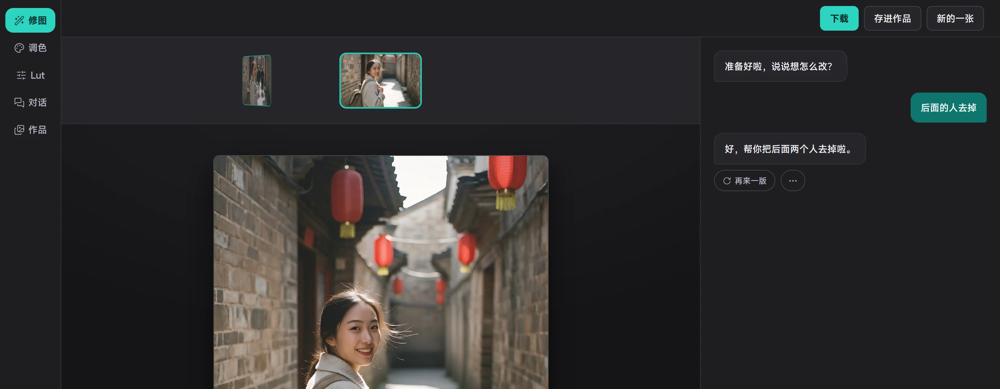

<p align="center">
  
</p>

<h1 align="center">PinkRose</h1>

<p align="center">
  用一句话修照片，也保留每一次手动调整。<br>
  一个本地优先的对话式照片编辑器。
</p>

<p align="center">
  <a href="https://github.com/AnJia-He/PinkRose/releases"><b>下载桌面版</b></a>
  ·
  <a href="docs/desktop-release.md">安装与数据目录</a>
  ·
  <a href="PRODUCT.md">产品边界</a>
  ·
  <a href="docs/superpowers/specs/2026-10-20-capability-matrix.md">能力清单</a>
</p>



## PinkRose 是什么

PinkRose 是一款面向普通用户、摄影爱好者和摄影工作流的 AI 修图工具。
你可以直接说“后面的人去掉”“天空自然一点”“做一点胶片感”，也可以继续用滑杆、
曲线、蒙版、画笔和批量工作流精修。

它会先理解照片里的主体、光线、构图和你的意图。能用本机参数、画笔或图像处理完成的，
尽量留在本机；只有需要生成式改图时，才调用你在设置中接入的第三方模型服务。

最新代码中的桌面版**不需要登录**。每份安装和数据目录各自保存自己的照片、会话、
偏好和模型配置。

> [!IMPORTANT]
> 当前公开发布的 `v0.1.0` 安装包早于“无需登录”这次改动，仍使用本机账号注册 / 登录流程。
> 下一次桌面 Release 会同步最新代码；安装包的版本边界以对应 Release 说明为准。

## 你能用它做什么

### 对话修图

- 说人话调亮度、色彩、影调、构图和局部效果。
- AI 消除路人、换天空、扩图、修复老照片、风格化、换背景等。
- 每次生成保留版本记录，可以回退、重做或再生成一版。

### 手动精修

- 曝光、白平衡、HSL、曲线、色彩平衡、分离色调、锐化、降噪等完整调色参数。
- 裁剪、旋转、透视、镜头校正、径向 / 移轴虚化。
- 人像塑形、磨皮、美白、补光、妆容和局部调整。
- 文字、贴纸、形状、边框、画布、涂鸦、光效、双色调和可回改图层。

### 批量与摄影工作流

- 最多 20 张照片批量调色、统一画幅、加水印和打包下载。
- 拼图、九宫格、长图、全景、HDR、长曝光、焦点堆栈、证件照和打印排版。
- 照片动图、照片电影、短视频调色、社交封面和 LUT 导入导出。
- 读取常见 EXIF / ICC 信息；支持 JPG、PNG、WebP、HEIC / HEIF、TIFF 和多种 RAW。

### 相机与文件

- 浏览器实时相机。
- 本机 tether 文件夹桥接。
- 部分 Canon / Sony / 通用 PTP 机型的高级拍摄控制。
- 相机适配器加载点，方便继续接厂商 SDK。

## 下载与安装

前往 [GitHub Releases](https://github.com/AnJia-He/PinkRose/releases) 下载对应安装包：

| 系统 | 推荐文件 | 说明 |
|---|---|---|
| Windows 10 / 11 x64 | `windows-x64-setup.exe` | 安装版 |
| Windows 10 / 11 x64 | `windows-x64-portable.exe` | 免安装版 |
| macOS Apple 芯片 | `mac-arm64.dmg` | M 系列芯片 |
| macOS Intel | `mac-x64.dmg` | Intel 芯片 |
| Linux x64 | `.AppImage` | 赋予执行权限后运行 |
| Linux x64 | `.deb` | Debian / Ubuntu 安装 |

首次打开会询问数据文件夹，推荐使用系统“文档”里的 `PinkRose` 目录。
以后可在「个人设置 → 文件保存位置」打开或更换；迁移只复制数据，不会自动删除旧目录。

> [!WARNING]
> 当前安装包没有配置商业代码签名和 Apple 公证。Windows SmartScreen 或 macOS
> Gatekeeper 可能提示“未知开发者”。请只在确认下载来源是本仓库后决定是否继续。

> [!NOTE]
> 当前 Release 主要提供桌面版。Web / PWA 和手机布局仍在持续验证，不是这一版的主要分发入口。

## 使用 AI 前必须知道

桌面版**不内置共享模型密钥**。安装包本身不能直接完成 AI 对话或生成式改图。

首次使用 AI 前，需要进入「个人设置 → 模型配置」，分别接入：

1. **对话与理解模型**：看照片、理解你的话、决定走本地参数还是生成。
2. **图片生成模型**：执行换天、去物、扩图、风格化等生成式编辑。

支持常见的 OpenAI 兼容接口，也支持 Anthropic 兼容接口。模型地址、模型名和 API Key
由使用者自己提供，费用、额度、可用性和服务条款由对应模型服务商决定。

没有配置模型时，这些功能仍然可用：

- 手动调色、裁剪、透视、镜头校正。
- 本地人像、局部调整、文字、贴纸和形状。
- 超清放大、批量处理、拼图、HDR、全景、焦点堆栈。
- 导出和作品管理。

## 数据去哪里

桌面版把数据保存在你选择的本地文件夹，主要包含：

```text
PinkRose/
├── pinkrose.db      # 作品、会话、偏好和模型配置
├── photos/          # 编辑中的照片和作品文件
├── luts/            # 导入的 LUT
└── .pinkrose-data.json
```

数据边界：

- 每份安装和每个数据目录彼此独立。打开别人的数据目录，才会看到别人的数据。
- PinkRose 不提供桌面版作品云同步，也不会把本地作品和会话汇总到维护者服务器。
- 本地调色、裁剪、人像、拼图、HDR、导出等操作不需要联网。
- 使用 AI 时，当前照片的必要预览、文字指令和必要上下文会从本机发送给**你配置的**
  模型服务商。
- 使用内置联网搜索时，只会发送检索所需的文字查询，不上传照片和长期偏好。
- 模型 API Key 在本机加密保存，不会通过模型列表接口返回明文。
- 更换或移除数据目录前，请自行备份。PinkRose 不会自动删除旧目录。
- 公开分享链接一旦生成，拿到链接的人就能查看对应作品；停止分享后链接失效。

## 当前明确边界

PinkRose 还在持续开发。以下内容目前不能当成已经完成：

- **安装包未签名**，可能出现 SmartScreen / Gatekeeper 提示；没有自动更新器。
- **AI 不是内置服务**，必须自备模型接口和额度，生成质量取决于所选模型。
- **RAW 不一定是完整解档**。本机没有 RawTherapee、darktable 或 LibRaw 时，
  可能只使用相机内嵌 JPEG 预览；完整位深和高光 / 阴影恢复会受限。
- **相机硬件没有全机型验证**。Canon CCAPI、Sony Camera Remote、PTP/IP 和厂商 SDK
  的能力、菜单名称及稳定性会随机型和固件变化。
- **Live Photo 导出是兼容包**，不是 Apple 原生 `.pvt` 重新封装。
- **广色域编辑仍统一在 sRGB 工作流**。能识别 Display P3、Adobe RGB 等源配置，
  但编辑链尚未完整升级到广色域。
- **联网搜索可能失败或没有结果**。此时软件会继续基于当前照片和上下文处理，
  不应把搜索结果当成唯一事实来源。
- **手机端不是当前正式分发重点**。已有 PWA / Safari 能力，但仍需继续验证。

## 从源码运行

环境要求：Node.js 24、npm，以及生成 HEIC / RAW / AVIF 等格式时所需的系统工具。

```powershell
npm ci
Copy-Item .env.example .env
npm run dev
```

然后打开 <http://localhost:5173>。

不要把真实 API Key、Token、Cookie、私钥或用户照片提交到仓库或公开 Issue。

常用验证：

```powershell
npm test
npm run typecheck
npm run build
npm run check:bundle
npm run desktop:prepare
npm run desktop:smoke
```

## 项目文档

- [产品定位与边界](PRODUCT.md)
- [桌面版安装、数据目录与发布](docs/desktop-release.md)
- [能力矩阵](docs/superpowers/specs/2026-10-20-capability-matrix.md)
- [设计与实现文档目录](docs/superpowers/specs)
- [开发入口](CLAUDE.md)
- [第三方组件说明](THIRD_PARTY_NOTICES.md)

## 反馈

欢迎通过 [Issues](https://github.com/AnJia-He/PinkRose/issues) 报告可复现的问题、
安装失败或能力边界描述不清。提交前请移除照片 EXIF、路径、密钥和其他个人信息。

本仓库当前没有附带开源许可证。Public 仓库表示源码可公开查看，不代表自动授予复制、
再分发、商用或二次发布权限；相关授权请先联系仓库维护者。
